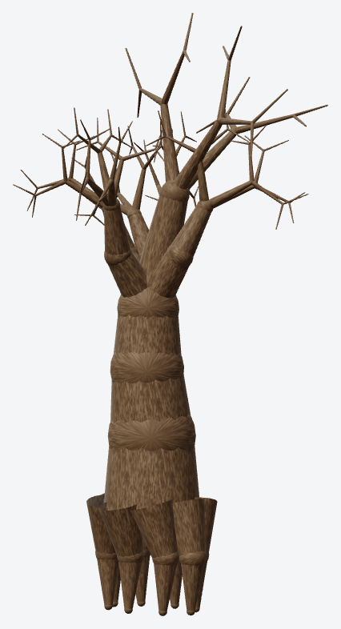
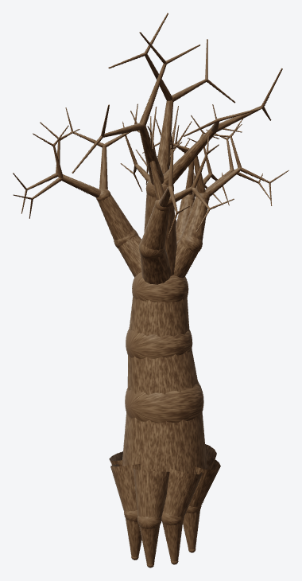
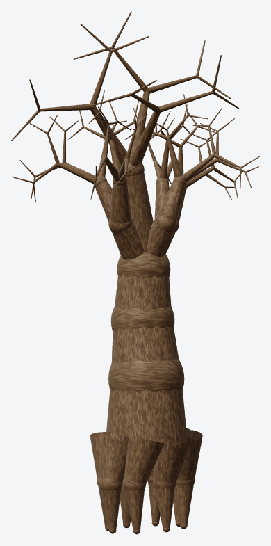
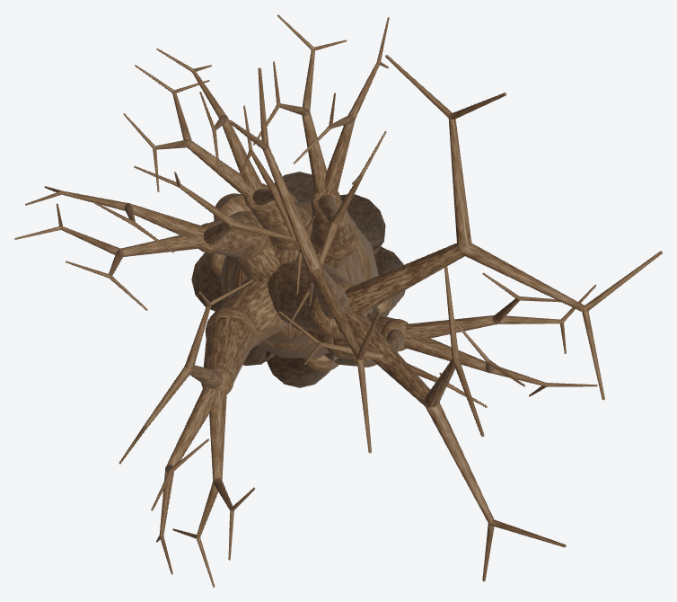

# Squid Game: OpenGL Trials

<p align="center">
  
</p>

<p align="center"><em>Game overview - the doll, contestants, arena lighting, and environment models rendered in real time.</em></p>

An interactive, Squid Game-inspired 3D simulation built from scratch with C++ and modern OpenGL. Play **Red Light, Green Light** and **Glass Bridge**, explore the scenes through cinematic cameras, and inspect how each model is assembled from reusable geometric primitives.

> This is an independent educational project. It is not affiliated with, endorsed by, or sponsored by Netflix or the creators of *Squid Game*.

## Feature tour

<video src="docs/media/feature-tour.mp4" title="Squid Game: OpenGL Trials feature tour" autoplay muted loop controls playsinline width="900">
  Your browser cannot play the video. <a href="docs/media/feature-tour.mp4">Open the feature tour video</a>.
</video>
<p align="center"><em>The feature tour starts muted automatically; use the controls to pause, seek, or enable sound.</em></p>

## Highlights

- Two playable rounds: Red Light, Green Light and Glass Bridge
- OpenGL 3.3 Core rendering with per-fragment Blinn-Phong lighting
- Directional, point, wall, and tracking spot lights
- Procedural models built from boxes, spheres, cylinders, cones, disks, and tori
- Textured sand, bark, and concrete environments
- 32 autonomous contestants, elimination animation, jumping, and glass-shard physics
- Multiple cinematic cameras plus a picture-in-picture doll camera
- Dear ImGui HUD and live controls
- Shape Inspector mode for learning and project demonstrations

## Visual report: large model studies

This section follows the structure of the written report. Each study gives the model a readable presentation image, a decomposition view, and the supporting technical views. The tree study is shown in full because it is the main landmark of the Red Light, Green Light arena.

### 1. Dead tree - complete model study

<p align="center"></p>
<p align="center"><em>Turntable overview - the complete gnarled tree asset used behind the doll.</em></p>

<p align="center"></p>
<p align="center"><em>Model decomposition - hierarchical parts built from reusable cylinders and branch segments.</em></p>

<p align="center"></p>
<p align="center"><em>Front view - silhouette, trunk placement, and branch spacing.</em></p>

<p align="center"></p>
<p align="center"><em>Isometric view - depth relationships between the trunk and branches.</em></p>

<p align="center"></p>
<p align="center"><em>Side view - profile used to validate the arena composition.</em></p>

<p align="center"></p>
<p align="center"><em>Top view - branch spread and ground footprint.</em></p>

### 2. Young-hee doll and face

<p align="center"></p>
<p align="center"><em>Face close-up - eye searchlights, smooth highlights, hair, cheeks, and facial geometry.</em></p>

<p align="center"></p>
<p align="center"><em>Body decomposition - head, hair, dress, collar, limbs, and support parts.</em></p>

<p align="center"></p>
<p align="center"><em>Head decomposition - face, eyes, pupils, brows, hair, and mouth components.</em></p>

### 3. Players and guards

<p align="center"></p>
<p align="center"><em>Player 456 - reusable contestant mesh and numbered tracksuit presentation.</em></p>

<p align="center"></p>
<p align="center"><em>Player construction - body, head, limbs, clothing, and bib assembled hierarchically.</em></p>

<p align="center"></p>
<p align="center"><em>Pink guard - mask, jumpsuit, weapon, and stance variations.</em></p>

<p align="center"></p>
<p align="center"><em>Guard construction - geometric mask, body, hands, boots, and weapon parts.</em></p>

### 4. Glass Bridge and gameplay environment

<p align="center"></p>
<p align="center"><em>Glass Bridge hall - the complete gameplay space and stage lighting composition.</em></p>

<p align="center"></p>
<p align="center"><em>Bridge structure - modular steel frame, paired glass panels, and safety rails.</em></p>

<p align="center"></p>
<p align="center"><em>Bridge decomposition - the reusable step, rail, beam, and panel components.</em></p>

<p align="center"></p>
<p align="center"><em>Shatter simulation - failed glass panels generate animated shards and a falling reaction.</em></p>

### 5. Lighting fixtures, architecture, and materials

<p align="center"></p>
<p align="center"><em>Round 1 lighting - directional sun, floodlight tower, and doll searchlight.</em></p>

<p align="center"></p>
<p align="center"><em>Round 2 lighting - floodlights, chandelier, wall lamps, and tracking spot.</em></p>

<p align="center"></p>
<p align="center"><em>Materials - the three seamless textures used throughout both rounds.</em></p>

## Report figure archive

The large studies above are the readable presentation layer. Supplementary report outputs - camera layouts, UI states, lighting comparisons, material swatches, turntables, and orthographic sheets - remain available in the [report figures directory](docs/report/source/figures/) and the [full project report](docs/report/Squid-Game-3D-Project-Report.pdf).

Useful technical references:

- [Round 1 camera layouts](docs/report/source/figures/cameras_rlgl.jpg) and [Round 2 camera layouts](docs/report/source/figures/cameras_gb.jpg)
- [Red Light, Green Light UI sequence](docs/report/source/figures/ui_rlgl_start.jpg), [green light](docs/report/source/figures/ui_rlgl_green.jpg), [red light](docs/report/source/figures/ui_rlgl_red.jpg), and [round result](docs/report/source/figures/ui_rlgl_won.jpg)
- [Glass Bridge turn HUD](docs/report/source/figures/ui_gb_turn.jpg) and [Glass Bridge result](docs/report/source/figures/ui_gb_won.jpg)
- [Primitive shape reference](docs/report/source/figures/basic_shapes.png)
- [Sand](docs/report/source/figures/tex_sand.jpg), [bark](docs/report/source/figures/tex_tree.jpg), and [concrete](docs/report/source/figures/tex_wall.jpg) material samples

## Rendering details

### Shading pipeline

The renderer uses a modern OpenGL 3.3 Core pipeline. Each mesh provides position, normal, colour, and UV attributes. The vertex shader transforms positions into clip space and carries world-space position, a correctly transformed normal, vertex colour, and texture coordinates to the fragment stage. The fragment shader then performs per-pixel lighting:

1. **Ambient term** keeps unlit surfaces readable.
2. **Diffuse Lambert term** responds to the angle between the surface normal and each light direction.
3. **Blinn-Phong specular term** produces focused highlights using the halfway vector between the light and camera.
4. **Material colour and texture sampling** are combined before distance haze and alpha handling.

This keeps the same material system usable for the arena, characters, props, bridge glass, and UI showcase scenes. The implementation is in [`default.vert`](src/shaders/default.vert) and [`default.frag`](src/shaders/default.frag).

### Lighting system

The game exposes independent light families that can be toggled while running:

| Light type | Scene role | Behaviour |
| --- | --- | --- |
| Directional | Arena sun / Glass Bridge floodlight array | Parallel rays for broad daylight or stage illumination |
| Point | Arena floodlight tower / Bridge chandelier | Local inverse-distance illumination with bright falloff |
| Wall fill | Four Glass Bridge wall lamps | Low-intensity local fill that prevents black corners |
| Spot | Doll eye searchlight / tracking follow-spot | Cone-limited light aimed at the target or active subject |

The physical fixtures are modeled in `src/render/LightFixtures.cpp`; shared light data lives in `src/core/Types.h`; scene-specific intensity and colour values are centralized in `src/core/Config.h`. Use `0`, `7`, `8`, and `9` to compare the lighting contributions live.

### Camera system

Round 1 provides seven views: third-person gameplay, overhead free camera, aerial top-down, doll close-up, stadium left, stadium right, and finish line. Round 2 provides five: player follow, 360-degree orbit, aerial top-down, side profile, and destination view. Mouse drag and the scroll wheel control orbit and zoom in the free camera. `F4` enables the picture-in-picture doll camera, while number keys switch the active cinematic shot.

### Texture pipeline

The project ships three seamless PNG textures in [`assets/textures`](assets/textures): sand for the arena floor, bark for the dead tree, and concrete for the Glass Bridge hall and platforms. `SceneTextures` loads them through the vendored `stb_image` decoder, and the renderer applies configurable UV repeat values so a small texture can cover large surfaces without stretching. The generated texture source is [`tools/make_textures.py`](tools/make_textures.py); the material examples are shown in the visual studies above.

## Tech stack

| Area | Technology |
| --- | --- |
| Language | C++17 and C |
| Graphics | OpenGL 3.3 Core, GLAD, GLFW, GLM |
| Interface | Dear ImGui |
| Audio | Windows MCI (`winmm`) |
| Build | CMake 3.20+ or MinGW-w64 `g++` |

## Quick start

### Requirements

- Windows 10 or later
- A GPU and driver with OpenGL 3.3 support
- CMake 3.20+
- A C++17 compiler
- GLFW and GLM development packages

With MSYS2 MinGW-w64, install the required toolchain:

```bash
pacman -S --needed mingw-w64-x86_64-toolchain \
  mingw-w64-x86_64-cmake \
  mingw-w64-x86_64-glfw \
  mingw-w64-x86_64-glm
```

Build from an MSYS2 MinGW 64-bit shell:

```bash
cmake -S . -B build -G "MinGW Makefiles" -DCMAKE_BUILD_TYPE=Release
cmake --build build --parallel
```

Run the game from the repository root:

```powershell
.\build\bin\squid_game_opengl.exe
```

The build copies shaders and available runtime assets beside the executable, so it can also be launched directly from `build/bin`.

### Optional soundtrack

Music is not distributed with the repository. To use a locally owned MP3, place it at:

```text
assets/audio/squid_song.mp3
```

The file is intentionally ignored by Git. The simulation works without it.

## Controls

### Global

| Key | Action |
| --- | --- |
| `P` | Switch between the two rounds |
| `I` | Toggle Shape Inspector |
| `0` | Toggle directional light |
| `7` | Toggle wall lights in Glass Bridge |
| `8` | Toggle point light |
| `9` | Toggle spot light |
| `F3` | Toggle VSync |
| `F4` | Toggle picture-in-picture doll camera |
| `R` | Reset the current round |
| `Esc` | Exit |

### Red Light, Green Light

| Key | Action |
| --- | --- |
| `W` / `S` or `Up` / `Down` | Move forward or backward |
| `A` / `D` or `Left` / `Right` | Turn left or right |
| `Z` / `X` / `C` | Select walk, jog, or sprint speed |
| `1`-`7` | Select a camera |
| Mouse drag / wheel | Orbit / zoom |

### Glass Bridge

| Key | Action |
| --- | --- |
| `A`, `Left`, or `Q` | Jump to the left panel |
| `D`, `Right`, or `E` | Jump to the right panel |
| `Tab` | Toggle fast-forward for AI turns |
| `S` | Skip to Player 456's turn |
| `1`-`5` | Select a camera |

## Project structure

```text
.
|-- assets/              Runtime textures and optional local audio
|-- docs/
|   |-- media/           README media
|   |-- presentation/    Project presentation
|   `-- report/          Report PDF, LaTeX source, and figures
|-- src/
|   |-- audio/           Sound effects and music playback
|   |-- camera/          Round 1 camera controller
|   |-- compat/          Compatibility drawing interface
|   |-- contestants/     Player and NPC simulation
|   |-- core/            Shared configuration and data types
|   |-- doll/            Doll, head, body, and tree models
|   |-- engine/          OpenGL abstractions and primitives
|   |-- environment/     Arena, architecture, and clock
|   |-- glassbridge/     Bridge gameplay, cameras, and physics
|   |-- guards/          Guard models and behavior
|   |-- render/          Scene rendering, lights, and textures
|   |-- shaders/         GLSL vertex and fragment shaders
|   |-- tools/           In-game showcase renderer
|   `-- vendor/          Vendored GLAD, Dear ImGui, and stb_image
|-- tools/               Asset and report-generation scripts
`-- CMakeLists.txt       Portable project build definition
```

Most gameplay tuning values live in [`src/core/Config.h`](src/core/Config.h). Rendering starts in [`src/main_modern.cpp`](src/main_modern.cpp), while the lighting pipeline is implemented in [`src/shaders/default.vert`](src/shaders/default.vert) and [`src/shaders/default.frag`](src/shaders/default.frag).

## Documentation

- [Project report](docs/report/Squid-Game-3D-Project-Report.pdf)
- [Presentation](docs/presentation/Squid-Game-3D-Presentation.pptx)
- [LaTeX report source](docs/report/source/report.tex)

## Regenerating assets and report figures

Generate the procedural textures:

```bash
python tools/make_textures.py
```

Capture the scripted report shots and assemble the figures:

```powershell
.\build\bin\squid_game_opengl.exe --capture docs\report\captures
python tools\make_report_figures.py
```

Python figure generation requires Pillow and NumPy.

## Contributing

Issues and pull requests are welcome. Keep changes focused, follow the existing module boundaries, and verify a clean Release build before opening a pull request. For larger features, open an issue first so the design can be discussed.

## License

No project license has been granted yet. The vendored libraries retain their respective licenses. Add a project-level `LICENSE` before redistributing or reusing the original source code.
